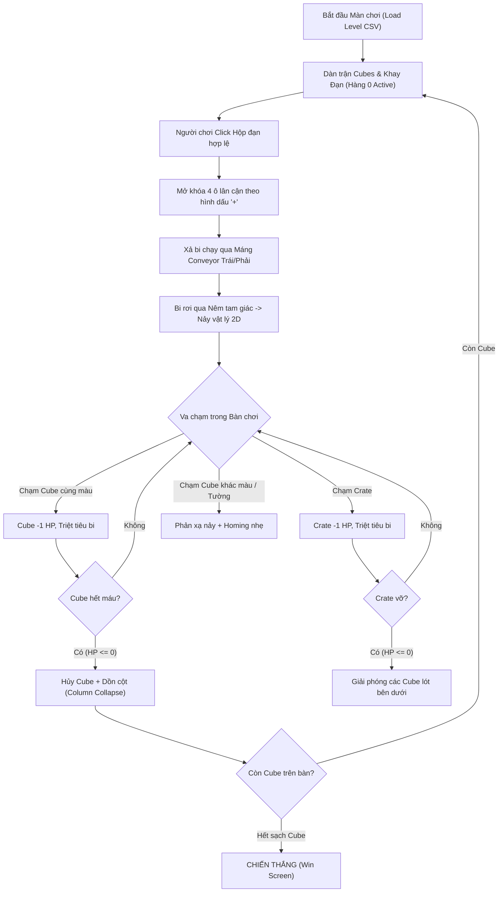

# Tài liệu Thiết kế: Core Gameplay Loop — Bounce Blast

> Mục đích: Mô tả chuẩn xác các quy tắc vận hành, cơ chế vật lý và cấu trúc logic cốt lõi của trò chơi để toàn bộ quá trình phát triển tuân thủ nhất quán.

---

## 1. Tổng quan Vòng lặp Trò chơi (Core Loop)

---

## 2. Các Thành phần Cơ bản

### 2.1 Bàn chơi (Board Grid & Cubes)
* **Lưới Gạch (Cubes):** Mỗi viên gạch có màu sắc (`colorCode`), chỉ số máu (`HP`) và vị trí tọa độ `(gridRow, gridCol)`.
* **Crate (Hòm Gỗ lớn):** Che phủ một nhóm các ô gạch. Khi hòm gỗ còn tồn tại, các viên gạch lót bên dưới ở trạng thái `isCovered` (ẩn hình ảnh và collider, nhưng giữ nguyên vị trí dữ liệu). Khi hòm gỗ bị phá hủy hoàn toàn (`HP <= 0`), các viên gạch bên dưới được mở khóa (`SetCovered(false)`).
* **Vật cản tĩnh (Walls, Stones):** Ngăn cản đường đi của bi.

### 2.2 Khay Đạn (Ammunition Grid)
* Nằm ở phần dưới của bàn chơi.
* Lúc đầu chỉ có **hàng dưới cùng (hàng 0)** ở trạng thái mở khóa (`isActive = true`).
* Khi người chơi nhấn vào một hộp đạn có thể thao tác:
  1. Hộp đạn bắt đầu bắn ra các viên bi tương ứng.
  2. Kích hoạt mở khóa tức thì cho 4 ô lân cận theo hình dấu `+` (Manhattan Distance = 1).
  3. Sau khi bắn hết số lượng bi, hộp đạn biến mất tại chỗ.

### 2.3 Máng Băng Chuyền (Conveyor Rails) & Điểm Phun Bi
* 2 đường ray uốn lượn 2 bên sườn bàn chơi (Trái và Phải) luân phiên nhận các đợt bắn từ hộp đạn.
* Bi di chuyển kinematic dọc theo các mốc tọa độ (Waypoints) từ dưới đáy lên đến đỉnh trần.
* Tại đỉnh trần, bi được phóng xuống qua **Nêm tam giác (Triangle Deflector Wedge)** để phân tán đều ra 2 bên bàn chơi.

### 2.4 Vật lý & Điều khiển Bi (Ball Physics & Smart Homing)
* **Vận tốc Arcaded chuẩn:** Bi bay với tốc độ ổn định (`targetSpeed = 16f`, `gravityScale = 0`) giúp phản xạ dứt khoát và quỹ đạo rõ ràng.
* **Smart Homing:** Khi không trong thời gian phản xạ (cooldown), bi nhẹ nhàng uốn cong quỹ đạo về phía viên gạch cùng màu gần nhất.
* **Anti-Stuck Trap:** Tự động phát hiện và bẻ góc lệch nếu bi bị kẹt trong chuyển động ngang 1D giữa 2 vách tường.
* **Zero Collision Layer:** Các viên bi được gán vào layer riêng `Ball` và bật `Physics2D.IgnoreLayerCollision("Ball", "Ball", true)` để bi không va chạm làm cản trở nhau.

---

## 3. Kiến trúc Mã nguồn Tách rời (Decoupled Architecture)

* **`LevelCsvParser`:** Phân tích dữ liệu CSV thành `LevelData` (POCO) độc lập hoàn toàn với Scene.
* **`BounceBlastLevelSpawner`:** Tiếp nhận `LevelData` để Instantiate các đối tượng đồ họa và cấu hình lên bàn chơi.
* **`AmmoBalancer`:** Thuật toán tính toán và phân phối số lượng đạn theo từng màu khớp chính xác với tổng HP gạch tương ứng.
* **`ColorPalette` & `BoardLayoutConfig` (ScriptableObject):** Quản lý toàn bộ hằng số màu sắc, kích thước, tọa độ máng không hard-code.
* **`GameplayManager` (Coordinator):** Điều phối các hệ thống con:
  * `InputController`: Nhận diện touch/click.
  * `AmmoGrid`: Quản lý trạng thái và mở khóa ô đạn.
  * `BallPool`: Tái sử dụng đối tượng bi (Zero GC).
  * `BoardState`: Theo dõi gạch, bi và điều kiện thắng.
  * `ColumnCollapse`: Dồn cột mượt mà khi gạch bị tiêu diệt.
